# Awesome-Git-DIFF-Utilities-Code-Review-Tools

  

  
  
  
  
  

# 🔎 Top Git Diff Utilities, Syntax Highlighters & Code Review Tools

> A curated directory of the best **Git diff utilities**, **code review platforms**, **syntax-highlighted diff viewers**, **3-way merge tools**, and **AI pull-request reviewers**. Includes commercial SaaS solutions with pricing matrices and self-hosted open-source GitHub projects.

**Last updated: November 2026**

---

## 📌 Executive Summary & Key Highlights

This repository serves as a developer guide and benchmark for **Git diff tools and code review systems**. Whether you need:
- **Interactive Terminal & Syntax Diff Highlighters**: Enhancing command-line `git diff` output with word-level diffing, syntax highlighting, and structural AST comparisons (`delta`, `Difftastic`, `diff-so-fancy`, `munder-difflin`).
- **Self-Hosted & Enterprise Code Review Platforms**: Managing patch-based or PR workflows on-premises or private cloud without recurring per-seat costs (`Gerrit`, `Phorge`, `Review Board`, `Forgejo`, `Gitea`).
- **Visual 3-Way Merge & Conflict Resolution**: Interactive GUI side-by-side comparison for complex Git merge conflicts (`Beyond Compare`, `Meld`, `KDiff3`, `WinMerge`).
- **AI-Assisted Code & PR Reviewers**: Automated pull-request triage, context-aware bug analysis, and inline code suggestions (`Qodo PR-Agent`, `CodeRabbit`).
- **Developer Desktop Git Clients & PR Dashboards**: Streamlining review cycles right inside the terminal or GUI (`GitKraken`, `Fork`, `Tower`, `gh-dash`, `Diffview.nvim`, `Lazygit`).

---

## 📑 Table of Contents

- [📊 Sector Overview & Market Dynamics](#-sector-overview--market-dynamics)
- [☁️ SaaS/Hosted & Commercial Platforms](#️-saashosted--commercial-platforms)
- [💻 Open-Source GitHub Projects](#-open-source-github-projects)
  - [Terminal Diff Highlighters & CLI Utilities](#-terminal-diff-highlighters--cli-utilities)
  - [Self-Hosted Code Review Platforms](#-self-hosted-code-review-platforms)
  - [AI-Powered PR Review Agents](#-ai-powered-pr-review-agents)
  - [Visual Merge Suites & GUI Diff Tools](#-visual-merge-suites--gui-diff-tools)
  - [Terminal & Editor PR Dashboards](#-terminal--editor-pr-dashboards)
- [🎯 Comparison Matrix: CLI Diff Tools vs GUI Merge Suites](#-comparison-matrix-cli-diff-tools-vs-gui-merge-suites)
- [🛠️ How to Contribute](#️-how-to-contribute)
- [⚠️ Disclaimer](#️-disclaimer)
- [💖 Support & Community](#-support--community)

---

## 📊 Sector Overview & Market Dynamics

The global Code Review, Static Analysis & Version Control Collaboration Software market is valued at approximately **$14.5B–$18.2B+ in 2026**, expanding at a ~18%–23% CAGR propelled by AI-generated pull-request volume, stacked-diff workflows, and structural AST code comparison. 

The cloud code-hosting and PR platform layer exhibits **strong winner-take-most consolidation** around Microsoft GitHub and GitLab, while the **terminal/web diff utilities, structural AST diff engines, self-hosted patch-review servers, and AI PR review agents are heavily powered by open-source software** (`delta`, `Difftastic`, `Gerrit`, `Review Board`, `Qodo PR-Agent`, `Meld`).

---

## ☁️ SaaS/Hosted & Commercial Platforms

*Curated commercial platforms and enterprise code review software, sorted descending by company valuation / annual revenue scale.*

| Platform | Description | Company Scale (Valuation / Revenue) | Starting Paid Tier | Free Tier / Trial Limit |
| :--- | :--- | :--- | :--- | :--- |
| **[GitHub Pull Requests (Microsoft)](https://github.com)** | Industry-standard cloud pull-request review platform featuring inline diff suggestions, CODEOWNERS, merge queues, and Copilot code review. | **Part of Microsoft / GitHub** (~$2B+ GitHub ARR; ~$3T+ Microsoft market cap) | **$4 / user / month** for GitHub Team (adds required reviewers & protected branches on private repos) | **Forever Free Plan** (**Unlimited public and private repositories** with pull requests, inline code diffs, and unlimited collaborators) |
| **[Atlassian Crucible](https://atlassian.com)** | Enterprise peer code review server supporting pre-commit and post-commit diffs, threaded inline comments, and Jira/Bitbucket integration. | **Part of Atlassian Corp.** (~$4.5B+ annual revenue; ~$55B+ public market cap) | **$10 one-time** Starter license (up to 5 users) or **$1,100+ one-time** for 10+ users (Data Center/Server) | **30-Day Full-Access Free Trial** (Full enterprise code review suite for 30 days; low-cost $10 5-user starter license) |
| **[GitLab Merge Requests (GitLab Inc.)](https://gitlab.com)** | Unified DevSecOps merge-request review platform featuring multi-line diff suggestions, approval rules, SAST security diff reports, and merge trains. | **~$750M+ Annual Revenue** (~$8B–$10B+ public market cap on NASDAQ) | **$29 / user / month** billed annually for GitLab Premium (multi-approver rules & merge trains) | **Forever Free Tier** (Up to **5 users** on SaaS with full merge requests & inline diffs; unlimited users on self-hosted GitLab CE) |
| **[GitKraken Client](https://gitkraken.com)** | Cross-platform desktop Git GUI and CLI featuring an interactive 3-way merge conflict editor, word-level diffs, and in-app GitHub/GitLab PR reviews. | **~$50M–$100M Est. Valuation** (~$20M+ est. ARR; >30M developers; acquired GitLens) | **$4.95 / user / month** billed annually (Pro tier for private repos & cloud Workspaces) | **Forever Free Plan** (100% free for **local and public cloud repositories**; paid plan required for private cloud repositories) |
| **[GerritHub (GerritForge)](https://gerrithub.io)** | Cloud-hosted Gerrit Code Review SaaS synchronized directly with GitHub repositories for patch-set-by-patch-set enterprise code review. | **Bootstrapped UK Enterprise Open-Core Vendor** (GerritForge Ltd.; core Gerrit maintainers) | **Custom Enterprise Support / Private Hosting** (Managed private GerritHub instances & SLA support) | **Forever Free for Public GitHub Repos** (100% free hosted Gerrit code review for all public open-source GitHub repositories) |
| **[Reviewable](https://reviewable.io)** | Dedicated GitHub pull-request code review SaaS tracking per-file read states, cross-revision diff comparisons, and unresolved discussion threads. | **Bootstrapped Indie Developer SaaS** (Profitable specialized GitHub PR review platform) | **$10 / active contributor / month** (or **$12/mo** monthly for private repository code reviews) | **Forever Free for Public Open-Source Repos** (100% free unlimited code reviews for all public GitHub repositories + 30-day private trial) |
| **[Beyond Compare Cloud / Enterprise (Scooter Software)](https://scootersoftware.com)** | Gold-standard folder, file, source-code, data, and 3-way merge comparison utility deployable across cloud VMs and developer workstations. | **Bootstrapped US Software Vendor** (Profitable 25+ year developer-tools company) | **$35 one-time** Standard license or **$70 one-time** Pro license (adds 3-way merge & cloud/SFTP sync) | **30-Day Full-Access Free Trial** (30 actual days of active use—not calendar days—with full Pro 3-way merge features) |
| **[Tower (fournova)](https://git-tower.com)** | Native macOS and Windows desktop Git client featuring single-line/hunk diff staging, stacked PR workflows, interactive rebase, and instant undo. | **~$10M–$25M Est. Scale** (Profitable independent German Git software vendor) | **$69 / user / year** (Basic plan) or **$99 / user / year** (Pro plan with stacked PRs & worktrees) | **30-Day Full-Access Free Trial** (Includes full Pro features for 30 days; free licenses for students, teachers, and open-source maintainers) |
| **[Fork (Dan Pristupov)](https://git-fork.com)** | Fast, native macOS and Windows Git GUI client offering interactive line/hunk diffs, visual 3-way merge conflict solver, and PR/reflog inspection. | **Bootstrapped Indie Software** (Profitable independent two-person developer team) | **$59.99 one-time** perpetual license (valid across macOS and Windows with 3 years of updates) | **Unlimited Evaluation Trial** (Free download with no time cutoff and periodic purchase reminders; one-time license removes prompt) |
| **[SmartGit (syntevo)](https://syntevo.com)** | Cross-platform desktop Git client (Windows, macOS, Linux) with built-in file compare, 3-way conflict solver, and GitHub/GitLab PR review integration. | **Bootstrapped German Software Vendor** (Profitable 20+ year developer-tools company) | **$6.90 / month** billed annually ($82.80/yr) or **$189 one-time** perpetual commercial license | **Forever Free Non-Commercial License** (100% free for open-source developers, students, teachers, and hobbyists + 30-day commercial trial) |

---

## 💻 Open-Source GitHub Projects

### ⚡ Terminal Diff Highlighters & CLI Utilities

| Project | License / Tech Stack | GitHub Stars / Highlights | Description |
| :--- | :--- | :--- | :--- |
| **[delta (dandavison/delta)](https://github.com/dandavison/delta)** | MIT / Rust | ~24k+ ⭐ / Syntax-highlighting pager | Viewer for Git, diff, and grep output with side-by-side views, line numbering, word-diff highlight, and Git theme integration. |
| **[Difftastic (Wilfred/difftastic)](https://github.com/Wilfred/difftastic)** | MIT / Rust | ~20k+ ⭐ / Structural AST diff engine | Syntax-aware structural diff engine that compares code based on AST syntax trees using tree-sitter rather than plain text lines. |
| **[diff-so-fancy (so-fancy/diff-so-fancy)](https://github.com/so-fancy/diff-so-fancy)** | MIT / Perl & Shell | ~16k+ ⭐ / Human-readable terminal diffs | Strives to make Git diffs human-readable by removing noisy diff headers and clearly highlighting modified characters. |
| **[munder-difflin (chaitanyagiri/munder-difflin)](https://github.com/chaitanyagiri/munder-difflin)** | MIT / Go | Fast interactive CLI diff | Interactive terminal tool for inspecting Git diffs cleanly with keyboard navigation and instant hunk staging. |
| **[diff2html (rtfpessoa/diff2html)](https://github.com/rtfpessoa/diff2html)** | MIT / TypeScript | ~5k+ ⭐ / Web diff generator | Generates pretty HTML diffs from unified diff outputs for browser-based side-by-side or line-by-line inspection. |

### 🏛️ Self-Hosted Code Review Platforms

| Project | License / Tech Stack | Deployment / Architecture | Description |
| :--- | :--- | :--- | :--- |
| **[Gerrit Code Review](https://www.gerritcodereview.com/)** | Apache-2.0 / Java & TypeScript | Self-hosted / Patch-set based | Enterprise-scale web-based team code collaboration tool integrating directly with Git repository workflows. |
| **[Phorge (phorgeit/phorge)](https://we.phorge.it/)** | Apache-2.0 / PHP | Self-hosted / Differential engine | Community fork of Facebook's Phabricator, providing Differential pre-commit code review and task auditing. |
| **[Review Board](https://www.reviewboard.org/)** | MIT / Python & Django | Self-hosted / Multi-VCS | Web-based collaborative code and document review tool supporting Git, SVN, Perforce, and Mercurial. |
| **[Forgejo (forgejo/forgejo)](https://forgejo.org/)** | GPL-3.0 / Go & Vue | Lightweight self-hosted Git forge | Community-driven, privacy-focused Git hosting forge with built-in pull requests, review workflows, and diff tools. |
| **[Gitea (go-gitea/gitea)](https://gitea.com/)** | MIT / Go | Painless self-hosted Git service | Lightweight all-in-one Git service with rich pull-request reviews, syntax diff views, and branch protection. |

### 🤖 AI-Powered PR Review Agents

| Project | License / Tech Stack | Integration | Description |
| :--- | :--- | :--- | :--- |
| **[Qodo PR-Agent (Codium-ai/pr-agent)](https://github.com/Codium-ai/pr-agent)** | Apache-2.0 / Python | GitHub Actions, GitLab CI, Webhooks | Open-source AI-powered tool providing automated PR descriptions, code reviews, security audits, and suggested improvements. |
| **[Sweep (sweepai/sweep)](https://github.com/sweepai/sweep)** | Apache-2.0 / Python | GitHub App / Cloud / Local | AI junior developer and reviewer that handles code triage, bug fixes, and interactive PR feedback. |

### 🔀 Visual Merge Suites & GUI Diff Tools

| Project | License / Platform | Key Features | Description |
| :--- | :--- | :--- | :--- |
| **[Meld (GNOME)](https://meldmerge.org/)** | GPL-2.0 / Linux, Windows, macOS | 2-way and 3-way visual merge | Visual diff and merge tool targeted at developers, supporting 3-way comparison of files, directories, and version control. |
| **[KDiff3](https://kdiff3.sourceforge.net/)** | GPL-2.0 / Cross-platform (KDE) | 3-way auto-merge & directory diff | Compares and merges two or three text files or directories with automated conflict resolution algorithms. |
| **[WinMerge](https://winmerge.org/)** | GPL-2.0 / Windows | Side-by-side file & folder diff | Open-source differencing and merging tool for Windows with syntax highlighting, visual 3-way comparisons, and patch creation. |

### 🖥️ Terminal & Editor PR Dashboards

| Project | License / Platform | Integration | Description |
| :--- | :--- | :--- | :--- |
| **[gh-dash (dlvhdr/gh-dash)](https://github.com/dlvhdr/gh-dash)** | MIT / Go | GitHub CLI (`gh`) extension | Rich terminal dashboard for GitHub pull requests and issues with customizable view columns and instant checkout. |
| **[Diffview.nvim (sindrets/diffview.nvim)](https://github.com/sindrets/diffview.nvim)** | GPL-3.0 / Neovim | Neovim Lua plugin | Fast, extensible Neovim interface for cycling through Git diffs, merge conflict navigation, and file history. |
| **[Octo.nvim (pwntester/octo.nvim)](https://github.com/pwntester/octo.nvim)** | MIT / Neovim | GitHub API / Neovim | Edit and review GitHub issues, pull requests, and inline comments entirely inside Neovim buffers. |
| **[Lazygit (jesseduffield/lazygit)](https://github.com/jesseduffield/lazygit)** | MIT / Go | Cross-platform TUI | Simple terminal UI for Git commands featuring interactive staging, hunk discards, interactive rebase, and diff browsing. |

---

## 🎯 Comparison Matrix: CLI Diff Tools vs GUI Merge Suites

| Category | Primary Focus | Best Used For | Top Tools |
| :--- | :--- | :--- | :--- |
| **Terminal Syntax Diffs** | CLI speed & color syntax | Day-to-day command-line `git diff`, `git log -p` | `delta`, `Difftastic`, `diff-so-fancy` |
| **Structural AST Diffs** | Code semantics over lines | Refactoring, reformatted whitespace, moving code blocks | `Difftastic` |
| **Visual 3-Way Merge** | Complex conflict resolution | Resolving hairy merge conflicts, directory comparison | `Beyond Compare`, `Meld`, `KDiff3`, `WinMerge` |
| **Web / Forge Code Review** | Team collaboration & governance | Pull request approvals, inline discussion, merge queues | `GitHub PRs`, `GitLab MRs`, `Gerrit`, `Reviewable` |
| **AI PR Reviewers** | Automated code inspection | Catching security flaws, auto-generating summaries, linting | `Qodo PR-Agent`, `CodeRabbit` |

---

## 🛠️ How to Contribute

We welcome community contributions! To maintain list quality:
1. Fork this repository and create your feature branch (`git checkout -b feature/add-tool-name`).
2. Add your tool to the appropriate category table in alphabetical order.
3. Ensure pricing and free tier limits are clearly noted for commercial SaaS products (following repository conventions).
4. For open-source tools, include the license, GitHub link, and a concise summary.
5. Submit a pull request with a descriptive title and context.

---

## ⚠️ Disclaimer

Product names, logos, brands, and registered trademarks quoted in this document are the property of their respective owners. Mention of commercial platforms and open-source tools is for informational and educational curation purposes only and does not constitute endorsement. Pricing and plan details reflect publicly available information as of November 2026.

---

## 💖 Support & Community

If you find this repository helpful, consider starring ⭐ the repo and sharing it with colleagues!
- ⭐ **Star this repository** to stay updated with new diff engines and review tools.
- 💬 **Open an Issue** for suggestions, broken links, or tool recommendations.
- 🔀 **Submit a Pull Request** to add your favorite Git diff utility or code review workflow.
